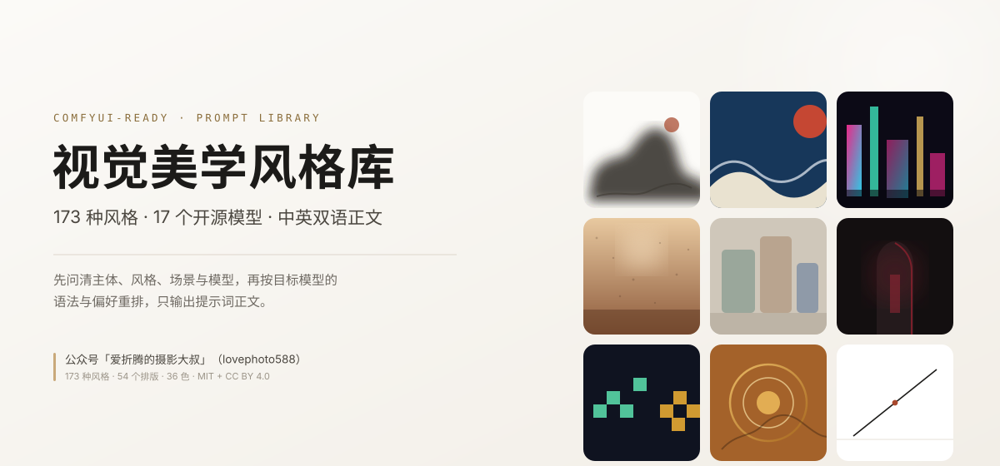
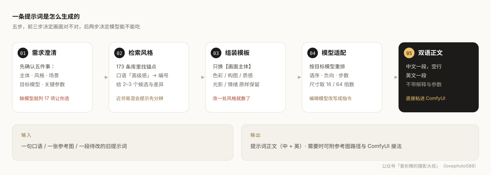

<p align="center">
  
</p>

<h1 align="center">视觉美学风格库 · vision-style-prompt</h1>

<p align="center">
  给 ComfyUI 用的中文生图提示词库：<b>173 种视觉美学风格</b>，按 <b>17 个开源模型</b>的语法分别渲染，<br>
  只输出提示词正文（中文一段、英文一段），直接粘进节点就能跑。
</p>

<p align="center">
  
  
  
  
</p>

> 作者：**爱折腾的摄影大叔**　公众号「爱折腾的摄影大叔」（lovephoto588）

> [!NOTE]
> **自由使用、修改、商用，只需保留署名。** 代码 MIT，内容 CC BY 4.0。
> 接单、做产品、集成进你卖的服务都可以；唯一要求是注明
> 公众号「爱折腾的摄影大叔」（lovephoto588）。详见 [署名要求](#署名要求) 与 [LICENSE](LICENSE)。

---

## 项目简介

做 AI 生图的人大多踩过同一个坑：想要「高级感」「日系干净」「有点旧」，但模型只认具体描述。翻了十几篇提示词教程，写出来的还是那几句"电影级布光、超清细节"，风格却始终差一口气。

这个项目把 173 种视觉美学风格拆成**可组装的模板**——每条风格固定七段：色彩、构图、质感、光影、画质、风格标记、情绪。你只需要替换开头的`【画面主体】`，后面五段原样保留，风格就锁住了。

它有三层，彼此正交：**风格**决定画成什么样（173 种），**排版**决定信息怎么摆（54 型），**配色**决定整体色调（36 色）。三层可以任意组合，所以同一句话能出「杂志封面」也能出「信息图」。

它解决三件事：

1. **说不清要什么** → 用关键词检索，或用画廊看图选。
2. **不知道怎么写** → 模板已调好，不靠自由发挥。
3. **换了模型就失效** → 同一段描述，按 Z-Image / FLUX.2 / Krea 2 / Qwen-Image 各自的语法重排。

不负责出图。它产出的是能粘进 ComfyUI 的文字。

<p align="center">
  
</p>

## 功能特性

| 能力 | 说明 |
|---|---|
| **173 种风格库** | 10 大类：中国古典 37、日本东亚 12、世界区域 12、西方流派 28、数字科幻 19、摄影光影 11、插画动画 19、色彩调性 13、亚文化 3、题材补位 19 |
| **需求澄清门禁** | 先确认主体、风格、场景、目标模型、关键参数；信息不足不直接出稿，模型未指定时列出 17 项等你选 |
| **17 个开源模型适配** | 语法、负向策略、步数、尺寸规则按模型重算，不是换个名字 |
| **中英双语正文** | 中文留档、英文投喂；两版段落一一对应，按同一模型语法分别渲染 |
| **参考图隔离** | `--with-ref` 自动追加隔离句：只提取线条、笔触、媒介、色彩、光影，不搬主体与构图 |
| **叠加冲突检测** | 媒介冲突、光影冲突、时代冲突三级告警，给出改法而不是只报错 |
| **主体体检** | 0–100 分，识别过短、含风格名、空泛评价词、否定句、抽象概念 |
| **批量一致性** | 一次生成一组，输出风格段哈希证明「每张风格完全一致」 |
| **图文画廊** | 173 张参考图 + 完整模板，可筛选、搜索、放大、复制 |
| **54 个排版图型** | 社媒卡 12 / 信息图 12 / 漫画分镜 10 / IP 卡 8 / 电商 12，按小红书、公众号题图、知识长图组织 |
| **36 个主题色** | 传统 12 / 现代中性 8 / 高饱和 8 / 暗调 4 / 自然 4，可覆盖风格配色段 |
| **可扩展** | 加模型只改一个 JSON；加风格只需放图 + 一条 Markdown |

### 支持的模型

| 模型 | 类型 | 语法要点 |
|---|---|---|
| Z-Image-Turbo | 文生图 | 9 步 / guidance 0，负向无效 |
| Z-Image | 文生图 | 非蒸馏，有 CFG |
| FLUX.2-klein-base-4B / 9B | 文生图 | 自然语句 50–150 词，base 有 CFG |
| FLUX.1-dev | 文生图 | guidance 3.5 走 FluxGuidance 节点 |
| FLUX.1-Kontext-dev | 编辑 | 改什么 + 保留什么 |
| Krea-2-Turbo / Krea-2 | 文生图 | 摄影词汇优先，Turbo 8 步 CFG 1.0 |
| Qwen-Image / 2512 / 2.1 | 文生图 | 中文长句，文字渲染强，16 倍数 |
| Qwen-Image-Edit / 2509 / 2511 | 编辑 | 指令式，多图用「图1/图2」 |
| FireRed-Image-Edit-1.1 | 编辑 | 指令式，中英文字都强 |
| MOSS-Image | 文生图 | 短句 + 可选 JSON 布局 |
| Fibo-2.0-dev | 两者皆可 | VGL 结构化描述，写短写具体 |

### 173 种视觉美学风格

| 风格数据 | 风格数据 | 风格数据 |
|---|---|---|
| .webp>) | .webp>) |  |
| .webp>) |  |  |
|  |  |  |

## 安装

**环境要求**：Python 3.9+（仅用标准库）；只有重建图片数据集时需要 `Pillow`。

**方式一：GitHub 克隆**

```bash
git clone https://github.com/lovephoto588/MYTX-vision-style-prompt.git
```

**方式二：zip 文件下载**

- 直接下载 **zip**，解压后放到本地，供 AI 调用。

本技能不绑定任何客户端：它就是一组 Python 脚本 + Markdown + 数据文件，放到任意目录都能跑，脚本按自身位置定位资源。

## 使用方法

### 1. 先说要什么，再出稿

```bash
# 打印该问的问题（按模型定制）
python scripts/intake.py --model Qwen-Image-2.1 --scene 电商主图

# 从一句话预填，再逐项补齐
python scripts/intake.py --from-text "国潮茶叶海报，用 Qwen-Image-2.1，3:4" -o brief.json

# 体检：信息够不够
python scripts/intake.py --check brief.json

# 风格没定：给三个方向（稳妥 / 邻类 / 反差），每个附画面描述
python scripts/intake.py --styles "安静 克制 旧"
```

体检不通过时 `scripts/build_prompt.py` 会直接拒绝出稿（退出码 4），而不是带着缺口硬写。

### 2. 出提示词

```bash
# 只有正文，最常用
python scripts/build_prompt.py -s "一只汝窑天青釉花口盘置于木案上，旁插一枝单瓣白梅，晨光自左侧斜入" \
  --style CN-01 --model Qwen-Image-2.1 --aspect 3:4 --bare
```

输出：

```
一只汝窑天青釉花口盘置于木案上，旁插一枝单瓣白梅，晨光自左侧斜入，宋代极简美学，极简静物构图，
自然柔光，色彩以天青、月白、藕灰为主，材质温润哑光，高级质感，超清细节。

a Ru-ware celadon foliate dish on a dark wooden table, a white plum blossom beside it, ...
```

要双语，就加一张对照表（英文由你或你的 agent 逐段译，脚本只负责按模型语法重排）：

```bash
python scripts/build_prompt.py --brief brief.json --model flux2-klein-base-9b \
  --en-map en.json --bare
```

英译稿（一个 JSON 文件，文件名随意）的结构：

```json
{
  "subject": "a celadon teapot on a wooden table, morning light",
  "segments": {
    "色彩以天青、月白、藕灰为主": "celadon, moon white and lotus grey palette",
    "极简静物构图": "minimalist still-life composition"
  },
  "edit": { "instruction": "replace the background with a sunset beach", "preserve": "the face and pose" }
}
```

缺译的段落会保持中文并给出提示，不会假装译过。

### 3. 带参考图

```bash
python scripts/build_prompt.py -s "主体描述" --style CN-12 --model flux2-klein-base-9b \
  --with-ref --bare
```

会在正文末尾追加一句：*参考图仅用于提取画风（线条、笔触、媒介、色彩与光影），不要沿用图中的主体、构图、场景与文字。* 非 `--bare` 模式下还会打印该风格的参考图路径，方便接到 IPAdapter / Reference Latent。

### 4. 编辑模型

```bash
python scripts/build_prompt.py -s "原图中的人物" --style CN-01 --model FLUX.1-Kontext-dev \
  --edit "把背景换成日落海滩" --preserve "人脸与姿势" --bare
```

### 4.5 加版式与配色

```bash
# 公众号题图 + 月白主调（画幅自动取该图型的首选 16:9）
python scripts/build_prompt.py -s "主体描述" --style CN-01 --model Qwen-Image-2.1 \
  --layout IG-01 --color 月白 --bare
```

`--layout` 决定信息怎么摆（54 型），`--color` 会整段替换风格原有的色彩段（36 色）。
两者与画风正交：风格 × 排版 × 配色，三维独立组合。

```bash
python scripts/layout_registry.py --families      # 五个家族
python scripts/layout_registry.py --suggest 小红书  # 按场景推荐
python scripts/layout_registry.py --show IG-04    # 看单型指令
python scripts/layout_registry.py --color 胭脂     # 查色
```

### 5. 其他常用命令

```bash
python scripts/find_style.py 水墨 --top 5        # 检索
python scripts/find_style.py --category CN        # 按大类浏览
python scripts/analyze_prompt.py "淡墨山水，留白，宣纸质感" --fix   # 反查现有提示词缺什么
python scripts/batch_prompt.py --style CN-01 --model z-image-turbo --subjects list.txt
python scripts/model_registry.py --list           # 17 个模型一览
python scripts/lint_prompt.py --model z-image-turbo -f prompt.txt                 # 日常自查（默认口径）
python scripts/lint_prompt.py --model z-image-turbo --strict -f prompt.txt        # 交付口径（技能自身交付流程用它）
python scripts/lint_prompt.py --model z-image-turbo --strict --style CN-01 -f prompt.txt  # 带上所选风格，避免自算参照
python scripts/lint_prompt.py --selftest                                          # 参照闸门自测（3 正 3 反）
```

**对裸模板跑 lint 会提示维度不足，属预期**——模板只有风格段，没有主体与光影；请对成稿（模板 + 主体）跑，别拿裸模板当基线。173 条库内成稿已做回归，全部 exit 0。

**三档口径**：① 默认只拦硬伤（超预算 / 禁用语法 / 标签堆砌 / 覆盖不足 / 人名 / 参照超限），不误伤极简与抽象题材；② `--strict` 是**交付口径**，另把「低于预算下限」「缺色彩主张」「缺动机光源」判 FAIL；③ `--no-aesthetic` 是逃生门——极简/抽象/编辑指令本来不写色彩主张时用它放行，并在交付说明里注明用了逃生门。

**参照计数的三档**：库外锚点（`references/style-anchors.md` 的 24 条）**>2 判不合格**、正好 2 个只提示；库内条目名按 code 去重后 **=3 只提示、≥4 判不合格**（装配器上限是 3 个风格）。`--style` 传本次选用的编号可把自身剔除，避免误报。

## 目录结构

```
vision-style-prompt/
├── SKILL.md                    技能契约：工作流、门禁、交付格式、红线
├── README.md                   本文件
├── LICENSE                     MIT（代码）+ CC BY 4.0（内容）
├── assets/
│   ├── styles-173.json         173 条风格数据（派生，由 rebuild_library.py 生成）
│   ├── models.json             18 个模型档案（17 个可选 + generic 兜底）
│   ├── layouts.json            5 家族 54 个排版图型
│   ├── colors.json             36 个单色主题色
│   ├── author.json             署名单一数据源
│   ├── reference-map.json      编号 → 参考图 + sha1
│   ├── living-names.json       姓名净化判据（23 人 + 可照抄的特征改写）
│   ├── gallery.html            图文画廊（单文件，离线可用）
│   └── dataset/
│       ├── images/001-100/…    480px WebP 缩略图
│       ├── images/101-200/…
│       ├── _grid/{CAT}.webp    每类拼版
│       └── manifest.jsonl      一行一条：七维特征 + 模板 + 图片 + 出处
├── references/
│   ├── models.md               模型手册与 ComfyUI 速查
│   ├── layouts.md              排版图型手册（54 型 + 场景映射）
│   ├── colors.md               配色手册（36 色 + 选色规则）
│   ├── dataset.md              数据集字段与扩充方法
│   ├── taxonomy.md             10 大类总表
│   ├── confusion.md            18 组易混风格辨析
│   ├── subject-craft.md        主体写法
│   ├── prompt-craft.md         叠加、冲突、负向、跨语言
│   ├── recipes.md              15 个成品范式
│   ├── walkthroughs.md         7 个组装案例（含一核五创）
│   ├── craft-color-light.md    色彩比例、配色方案、打光六项
│   ├── craft-composition-lens.md 构图骨架、纵深、焦距与景深
│   ├── pairing-rules.md        8 条搭配规则 + 雷区（人工自检）
│   ├── creative-modules.md     四类创意策略 + 组件库
│   └── style-anchors.md        24 条库外参照（只写可观察特征）
├── docs/images/                README 配图
└── scripts/
    ├── intake.py               需求采集与体检
    ├── build_prompt.py         组装（--model / --brief / --bare / --with-ref）
    ├── batch_prompt.py         批量与一致性哈希
    ├── find_style.py           检索
    ├── analyze_prompt.py       反查与补全
    ├── model_registry.py       模型档案加载、校验与预算读取
    ├── layout_registry.py      排版图型与主题色的检索/推荐
    ├── model_render.py         四种渲染器
    ├── name_guard.py           净化名单加载与姓名扫描
    ├── lint_prompt.py          成品提示词自检 8 项（交付前闸门，含 --selftest）
    ├── build_dataset.py        参考图 → 缩略图 + 清单
    ├── make_gallery.py         生成 gallery.html
    ├── rebuild_library.py      从源 Markdown 重建 JSON
    ├── validate_library.py     全库体检
    └── stamp_author.py         署名同步与检查
```

## 配置说明

所有可调项都在 `assets/` 下的 JSON 里，改完跑一次 `scripts/validate_library.py` 即可。

### models.json（17 个模型）

| 字段 | 作用 |
|---|---|
| `renderer` | `tag` / `prose` / `json_layout` / `cn_structured`，决定用哪套语法 |
| `segment_order` | 七段在该模型里的优先顺序（有的看重光，有的看重材质） |
| `negative` 的 `mode` | `separate` / `inline` / `none` / `ignored` / `weak` / `flag` |
| `params` | 步数、CFG、采样器；不确定的字段留说明，不要编 |
| `aspects` | 比例 → 合法分辨率（64 或 16 的倍数） |
| `supports` | 是否支持文字、透明底、参考图、权重 |
| `comfyui` | 工作流、尺寸约束、负向接哪 |
| `license` | 许可与商用限制 |
| `budget` | 字数预算的**唯一出处**：`zh`/`en` 各给 `unit`+`min`+`max`，`enforce` 取 `max`（只查上限）/ `both`（上下限都查）/ `none`（不以长度为准），`source` 取 `official`（官方给出）/ `note`（沿用库内既有口径）/ `heuristic`（按语感推定，未实测）。`syntax` 里不再写 `max_words` |

新增模型：往 `models[]` 加一项 → 复用现有 renderer（改 `segment_order` 就能表达偏好）→ 跑体检。只有出现全新语法时才动 `scripts/model_render.py`。

### layouts.json（54 个排版图型）

| 字段 | 类型 | 说明 |
|---|---|---|
| `id` | string | `家族码-两位序号`，如 `IG-04`。**家族内连续、不复用退役号** |
| `family` | string | 必须是 `families[]` 里已登记的码：`SM` / `IG` / `CM` / `IP` / `EC` |
| `name` | string | 中文短名，2–6 字，用于检索与展示 |
| `aspects` | string[] | 画幅数组，**首选放第一**（`--layout` 会自动取它） |
| `use` | string | 一句话用途，写场景不写画风 |
| `prompt_zh` | string | 中文版面指令：说方位、比例、层级，**不写画风、不写颜色** |
| `prompt_en` | string | 与中文一一对应的英文指令 |
| `density` | string | 信息密度：`低` / `中` / `高`，用于判断是否要能写字的模型 |

新增一步：在 `layouts[]` 末尾加一条 → 按需更新 `families[].count` 与 `scene_map` → 跑 `scripts/validate_library.py`（会查编号唯一、家族存在、中英指令齐全、画幅格式、`scene_map` 指向）。

```json
{
  "id": "SM-13",
  "family": "SM",
  "name": "竖排大字",
  "aspects": ["3:4", "9:16"],
  "use": "金句封面",
  "prompt_zh": "标题竖排靠右，占画面三分之一宽度，主体在左侧",
  "prompt_en": "Vertical headline on the right taking one third of the width, subject on the left",
  "density": "低"
}
```

### colors.json（36 个主题色）

| 字段 | 说明 |
|---|---|
| `id` | `C-两位序号`，连续不复用 |
| `name_zh` / `name_en` | **提示词里写色名，不写 hex** |
| `hex` | 仅供设计参考，必须 `#RRGGBB` |
| `family` | 传统 / 现代 / 高饱和 / 暗调 / 自然 |
| `value` | 明度：极浅 / 浅 / 中浅 / 中 / 中深 / 深 / 极深 / 亮 |
| `use` / `pairs` | 适用场景、建议搭配 |

### 其他配置

- **intake_slots**：采集问卷的槽位与顺序，改这里就能调整提问。
- **en-map**：中英对照表，`subject` + `segments` + `edit` 三段，缺项会提示。
- **数据集**：`python scripts/build_dataset.py --max 640 --quality 80` 可改缩略图规格；`--source` 指定原图目录。
- **署名**：只改 `assets/author.json`，再跑 `python scripts/stamp_author.py --fix`。

## 数据集与画廊

打开 `assets/gallery.html`：173 张参考图按大类排好，可按名称/编号/模板关键词搜索，点开看大图与完整模板，支持 ← → 翻页与一键复制。

数据集的用途不止看：

- **生成时**：`--with-ref` 取该风格缩略图路径，配合隔离句使用。
- **训练时**：`assets/dataset/manifest.jsonl` 一行一条，可导出做 LoRA；需要高分辨率就按 `source` 取原图。

⚠️ 缩略图是 480px 的浏览级素材，**不是训练级分辨率**；`SB` 亚文化类只有 3 张，各类数量 3–37 不均衡，适合当检索锚点，不适合当分类训练集。

## 常见问题

**Q：模型没指定会怎样？**
A：列出 17 项编号清单并停止，不会替你默认一个。

**Q：为什么必须给英文？**
A：SDXL / FLUX / Krea 2 的编码器以英文为主，中文段命中率低。中文版留档，英文版投喂。

**Q：参考图会不会把里面的人搬进来？**
A：不加隔离句就会。`--with-ref` 会追加隔离句，明确只取画风。

**Q：能直接出图吗？**
A：不能。本技能只产出提示词。ComfyUI 里粘贴正文，参数按提示设置。

**Q：想固化一个自己的版式，怎么加？**
A：往 `assets/layouts.json` 的 `layouts[]` 加一条，编号接在对应家族末尾（现有 54 条，SM-13 起），写清画幅、文字层级与中英指令，跑一次 `scripts/validate_library.py` 即可。字段表见上文「配置说明」。

**Q：Qwen-Image-2.1 能商用吗？**
A：权重是 Qwen Research License，商用需单独授权。FLUX.1-dev 亦为非商用。接商单前先确认许可。

## 参与贡献

欢迎补风格、补模型适配、修数据。提交前请跑：

```bash
python scripts/validate_library.py    # 必须 0 错误、100 分
```

姓名扫描的边界：**索引表允许出现条目名，提示词正文与模板不允许**。`references/taxonomy.md` 是 10 大类目录，条目名就是它的内容，所以对它单点豁免（`NAME_SCAN_SKIP_DOCS` 只有这一个文件）；其余 references、SKILL、README 与提示词模板一律零容忍。

```bash
python scripts/stamp_author.py --check
```

新增风格请同时提供参考图，并在 `manifest` 里保留 `source` 出处，方便回溯。

提交即表示同意你的贡献以 MIT（代码）/ CC BY 4.0（内容）发布，署名归「爱折腾的摄影大叔（lovephoto588）」。

## 署名要求

本项目可以自由使用、修改、商业化，只有一个条件：**保留署名**。

### 你可以

| 场景 | 说明 |
|---|---|
| 个人与商用创作 | 给自己或客户做图，接单、开店、做物料都行 |
| 产品与服务 | 集成进付费软件、SaaS、内部工具，无需额外授权 |
| 二次开发 | 改脚本、加风格、做分支，闭源分发也可以 |
| 教学与内容 | 课程、社群、付费专栏，随便用 |
| 模型训练 | 用本库文本训练自己的模型，允许 |

### 你只需要

| 要求 | 说明 |
|---|---|
| 保留署名 | 在 README、关于页、页脚或产品说明中注明来源 |
| 保留许可 | 分发时附带本 LICENSE，或注明 MIT + CC BY 4.0 |
| 说明改动 | 改过就写一句「基于 … 修改」，不必公开代码 |
| 不暗示背书 | 不要宣称获得作者官方认证或合作 |

推荐署名格式：

```
提示词风格库 by 爱折腾的摄影大叔（lovephoto588）
https://github.com/lovephoto588/MYTX-vision-style-prompt
许可：MIT（代码） / CC BY 4.0（内容，需署名）
```

内部系统不方便公开展示时，在文档或关于页写一行即可。参考图片除外——它们不随本项目授权。

## 开源许可证

| 内容 | 路径 | 许可 |
|---|---|---|
| 代码 | `scripts/` | [MIT](LICENSE) |
| 风格文本与提示词模板 | `references/`、`assets/styles-173.json` | CC BY 4.0 |
| 排版图型与配色 | `assets/layouts.json`、`assets/colors.json` | CC BY 4.0 |
| 模型档案 | `assets/models.json` | CC BY 4.0 |
| 文档与配图 | `README.md`、`docs/` | CC BY 4.0 |
| 参考图片 | `assets/dataset/` | 不授权，仅随包作风格示意 |

- **商用**：允许
- **署名**：必需
- **无担保**：按现状提供，作者不承担使用后果
- **第三方模型**：权重按各自许可执行（Qwen Research License、FLUX.1 [dev] 非商用等），与本项目无关

## 联系方式

- 公众号：**爱折腾的摄影大叔**（`lovephoto588`）——更新提示词玩法、ComfyUI 工作流与踩坑记录
- 有问题优先在仓库提 Issue；涉及合作与授权，请通过公众号后台留言

如果这套库帮你省下了调提示词的时间，欢迎在公众号回个「风格库」，也欢迎把好用的风格提回来。

<!-- AUTHOR:BEGIN -->

## 关于作者

- **作者**：爱折腾的摄影大叔
- 公众号「爱折腾的摄影大叔」（lovephoto588）
- **许可**：MIT（代码） / CC BY 4.0（内容，需署名）
- **版权**：© 2026 爱折腾的摄影大叔，保留所有权利

> 转载、二次分发或商用，请保留上述署名与联系方式。

<!-- AUTHOR:END -->
